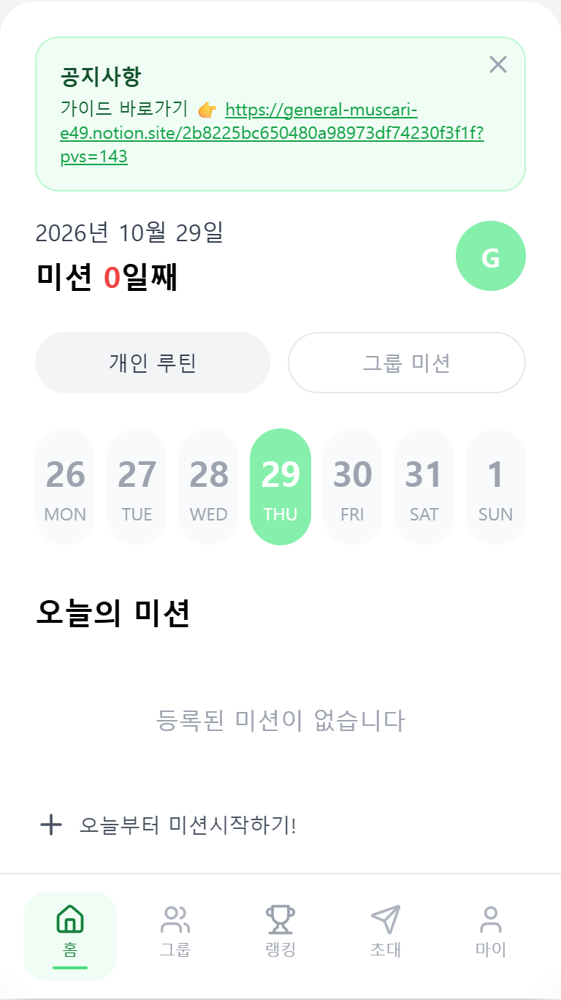
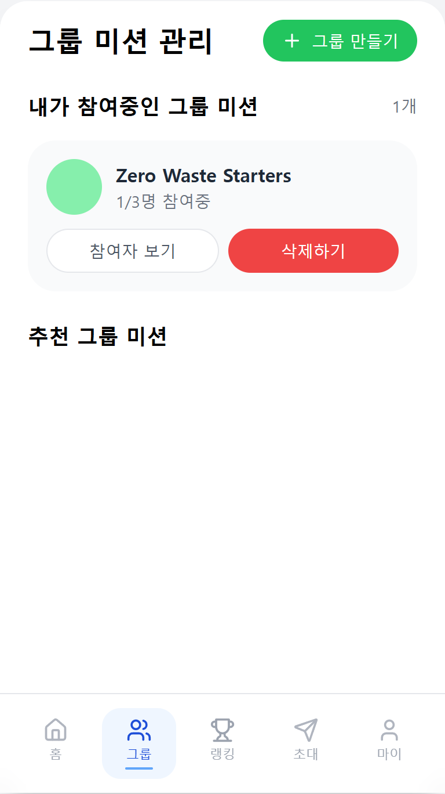
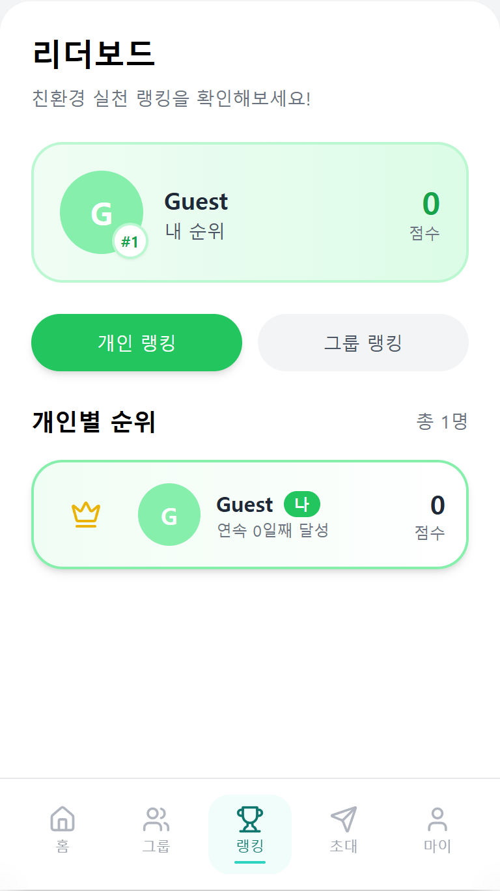
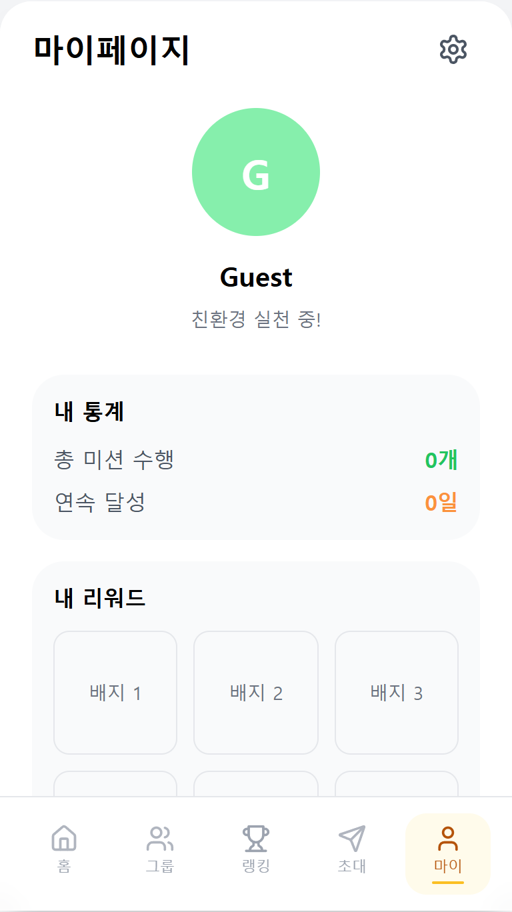

<div align="center">

# 🌱 Zero Waste Routine

**매일의 친환경 실천을 루틴으로 만들고, 그룹과 함께 이어가는 모바일 웹 서비스**

[](https://react.dev/)
[](https://www.typescriptlang.org/)
[](https://fastapi.tiangolo.com/)
[](https://zero-waste-routine.vercel.app/)

### [🚀 Live Demo](https://zero-waste-routine.vercel.app/)

</div>

## Preview

<table>
  <tr>
    <td align="center"><b>홈 · 개인 루틴</b></td>
    <td align="center"><b>그룹 미션</b></td>
    <td align="center"><b>리더보드</b></td>
    <td align="center"><b>마이페이지</b></td>
  </tr>
  <tr>
    <td></td>
    <td></td>
    <td></td>
    <td></td>
  </tr>
</table>

## 프로젝트 소개

환경을 위한 행동은 거창한 목표보다 작은 실천을 꾸준히 이어가는 것이 중요합니다. Zero Waste Routine은 일별 미션과 주간 루틴을 기록하고, 그룹 챌린지와 랭킹을 통해 친환경 행동을 자연스럽게 지속할 수 있도록 만든 서비스입니다.

포트폴리오 데모는 로그인 없이 바로 체험할 수 있는 공용 게스트 모드로 동작합니다.

## 주요 기능

- **개인 루틴** — 날짜별 친환경 미션 추가, 완료 체크, 주간 루틴 관리
- **그룹 챌린지** — 그룹 생성·참여, 참여자 확인, 공동 미션 수행
- **친구 초대** — 친구 추천과 그룹 초대, 수락·거절 흐름
- **리더보드** — 개인·그룹별 친환경 실천 점수와 순위 확인
- **프로필** — 닉네임, 소개, 프로필 색상과 활동 통계 관리
- **게스트 데모** — 회원가입이나 로그인 없이 핵심 기능 즉시 체험

## 기술 스택

| 영역 | 기술 |
| --- | --- |
| Frontend | React 18, TypeScript, Vite, Tailwind CSS |
| Backend | Python, FastAPI, SQLAlchemy, Pydantic |
| Database | SQLite (데모), PostgreSQL 호환 |
| Deployment | Vercel Services, Vercel Functions |
| Test | Pytest, FastAPI TestClient |

## 아키텍처

```text
Browser
   ├─ /          → Vite + React 정적 프런트엔드
   └─ /api/*     → FastAPI Vercel Function
                         └─ SQLAlchemy → SQLite / PostgreSQL
```

프런트엔드와 백엔드를 하나의 Vercel 프로젝트로 배포하며, `/api/*` 요청만 FastAPI 서비스로 전달합니다.

## 로컬 실행

### 1. 백엔드

```bash
cd backend
python -m venv .venv

# macOS / Linux
source .venv/bin/activate

# Windows
.venv\Scripts\activate

pip install -r requirements.txt
python init_data.py
uvicorn main:app --reload --port 8000
```

### 2. 프런트엔드

```bash
npm ci
npm run dev
```

- Web: http://localhost:5173
- API Docs: http://localhost:8000/docs

## 테스트 및 빌드

```bash
pip install -r backend/requirements-dev.txt
pytest
npm run build
```

현재 백엔드 테스트 6개와 프런트엔드 프로덕션 빌드를 통과합니다.

## 데모 데이터 안내

배포본은 별도 유료 데이터베이스 없이 실행하기 위해 Vercel Function의 임시 SQLite를 사용합니다. 새 함수 인스턴스가 생성되면 사용자가 추가한 데이터가 초기화될 수 있으며, 영구 저장이 필요한 운영 환경에서는 `DATABASE_URL`에 PostgreSQL을 연결할 수 있습니다.

## 프로젝트 구조

```text
.
├── src/                    # React 프런트엔드
│   ├── api/                # API 클라이언트
│   ├── components/         # 공통 UI 컴포넌트
│   └── pages/              # 주요 화면
├── backend/
│   ├── routers/            # FastAPI 라우터
│   ├── tests/              # API 테스트
│   ├── models.py           # SQLAlchemy 모델
│   └── main.py             # FastAPI 진입점
├── docs/screenshots/       # README용 실제 서비스 화면
└── vercel.json             # Vercel 멀티 서비스 설정
```
